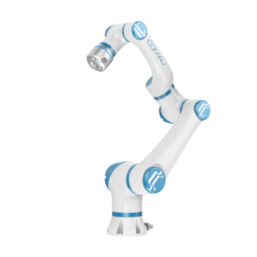

# MyCo Robot ROS 2

<p align="center">
  
</p>

[New API Reference](docs/API_description_new.md)

This repository provides MyCo robot models, a controller-backed ROS 2 hardware
interface, MoveIt, Gazebo, and operator interfaces for ROS 2 Humble.

## 1. Requirements and Build

- Ubuntu 22.04
- ROS 2 Humble
- Supported models: `MyCo-3-0.59`, `MyCo-5-0.80`, `MyCo-3.5-0.95`, `MyCo-10-1.00`, `MyCo-8-1.30`, and `MyCo-15-1.30`

Install dependencies:

```bash
sudo apt update
sudo apt install \
  ros-humble-controller-manager \
  ros-humble-ros2-control \
  ros-humble-ros2-controllers \
  ros-humble-joint-trajectory-controller \
  ros-humble-gazebo-ros2-control \
  ros-humble-moveit \
  python3-wxgtk4.0
```

Build and source the workspace:

```bash
cd ~/myco_ros2_ws
source /opt/ros/humble/setup.bash
colcon build --symlink-install
source install/setup.bash
```

Verify the active package path:

```bash
ros2 pkg prefix myco_robot_bringup
```

## 2. Unified Configuration

The unified entry point is:

```bash
ros2 launch myco_robot_bringup myco_control.launch.py
```

Operational parameters are stored in
`myco_robot_bringup/config/myco_control.yaml`:

```yaml
myco_control:
  robot_model: MyCo-5-0.80
  hardware_type: controller
  robot_ip: 10.20.215.133
  control_mode: position
  update_rate: 250
  enable_controller_validation: true

  servo_gain: 8000
  lookahead_time: 0.004
  servo_restart_idle_ms: 100
  position_command_epsilon: 1.0e-8
  velocity_command_epsilon: 1.0e-8
  command_log_throttle_ms: 100

  state_stale_timeout_ms: 100
  state_disconnect_timeout_ms: 1000
  pushed_state_port: 10004
  pushed_state_socket_timeout_ms: 100
  pushed_state_disconnect_timeout_ms: 1000
  status_publish_rate: 10.0
  io_publish_rate: 5.0
```

Configuration precedence is command-line override, YAML value, then launch
fallback. A command-line override applies to the current launch only.

## 3. Real Controller

Verify network and port access before launch:

```bash
ping ROBOT_IP
nc -vz ROBOT_IP 8892
nc -vz ROBOT_IP 8893
nc -vz ROBOT_IP 10003
nc -vz ROBOT_IP 10004
```

### 3.1 MoveIt Position Control

```bash
ros2 launch myco_robot_bringup myco_control.launch.py \
  robot_model:=MyCo-5-0.80 hardware_type:=controller control_mode:=position \
  robot_ip:=192.168.56.103
```

This mode starts controller communication, `ros2_control`, MoveIt, and RViz.
MoveIt executes trajectories through
`/myco_arm_controller/follow_joint_trajectory`.

### 3.2 Controller Control and State Monitoring

```bash
ros2 launch myco_robot_bringup myco_control.launch.py \
  robot_model:=MyCo-5-0.80 hardware_type:=controller control_mode:=controller \
  robot_ip:=192.168.56.103
```

This mode publishes live robot state while the ROS motion controller remains
`inactive`. No motion command is transmitted on port 8892.

## 4. GUI

Start controller bringup, the SDK node, and the new GUI:

```bash
ros2 launch myco_basic_api myco_gui_new.launch.py \
  robot_model:=MyCo-5-0.80 robot_ip:=192.168.56.103
```

Start only the new GUI when bringup and the SDK node are already running:

```bash
ros2 launch myco_basic_api myco_gui_only.launch.py \
  robot_model:=MyCo-5-0.80 robot_ip:=192.168.56.103
```

Start the legacy real-robot GUI:

```bash
ros2 launch myco_basic_api myco_gui.launch.py
```

Start the legacy fake GUI:

```bash
ros2 launch myco_basic_api fake_myco_gui.launch.py
```

The legacy GUI launch files start the interface only. Start the legacy Basic
API, MoveIt, TF, trajectory controller, and I/O services through the original
workflow.

## 5. Gazebo Simulation

```bash
ros2 launch myco_robot_bringup myco_control.launch.py \
  robot_model:=MyCo-5-0.80 hardware_type:=gazebo
```

This mode starts Gazebo, `gazebo_ros2_control`, state broadcasting, the
trajectory controller, MoveIt, and RViz. It does not connect to controller
ports.

The legacy EtherCAT entry point remains available:

```bash
ros2 launch myco_robot_bringup myco_control.launch.py \
  robot_model:=MyCo-5-0.80 hardware_type:=ethercat
```

## 6. Launch Parameters

| Parameter | Launch fallback | Description |
|---|---:|---|
| `config_file` | packaged YAML | Unified configuration file |
| `robot_model` | `MyCo-5-0.80` | Customer-facing ROS model name |
| `hardware_type` | `gazebo` | `controller`, `gazebo`, `ethercat`, or `fake` |
| `robot_ip` | `10.20.200.3` | Controller IP address |
| `control_mode` | `position` | `position`, or `controller` |
| `update_rate` | `250` | 250 for the CM 4 ms controller; 1000 for 1 ms controllers |
| `enable_controller_validation` | `true` | Validate the controller model and minimum version before startup |
| `servo_gain` | `8000` | Port 8892 StartServo gain |
| `lookahead_time` | `0.004` | ServoJ lookahead in seconds |
| `servo_restart_idle_ms` | `100` | Servo stream idle threshold in ms |
| `state_stale_timeout_ms` | `100` | Port 8893 stale-state threshold in ms |
| `state_disconnect_timeout_ms` | `1000` | Port 8893 reconnect threshold in ms |
| `pushed_state_port` | `10004` | JSON state stream port |
| `status_publish_rate` | `10.0` | Robot status rate in Hz |
| `io_publish_rate` | `5.0` | I/O state rate in Hz |

The complete launch parameter table is provided in the
[controller driver guide](docs/MyCo_ROS2_Controller_Driver_User_Guide.md).

## 7. Model, Version, and Cycle Requirements

Controller validation is performed before startup.

With controller validation enabled:

- the controller model shall pass validation against `robot_model`;
- the final `CM...` product-version field in the raw `ReadVersion`
  response shall be at least `6.5.20d`;
- model, version, or SDK read validation failure prevents `ros2_control` startup.

The seven-number SDK value such as `20260716.31339.0.8228.1315.107.0`
describes internal component versions and is logged for diagnostics only. It is
not used as the product version and cannot satisfy validation accidentally.

This customer driver is qualified with controller package
`CM6.5_4ms.23a1.20260716_T897.zip`. It uses a 4 ms controller cycle and the
default `update_rate` of 250 Hz. The `6.5.20d` value above is the generic lower
bound enforced by the preflight implementation, not the qualified package name.

The control rate shall match the `cycle_time` field in port 8893 data:

| Controller cycle | `update_rate` |
|---|---:|
| 1 ms | 1000 Hz |
| 4 ms | 250 Hz |

A cycle mismatch prevents hardware activation. Services, topics, units, and
communication paths are documented in the
[new API reference](docs/API_description_new.md).
