# MyCo ROS 2 Controller Driver User Guide

## 1. Driver Overview

### 1.1 Scope

This guide describes installation, startup, the new GUI, MoveIt motion planning, ROS interfaces, and troubleshooting for the MyCo ROS 2 controller driver.

Supported environment:

- Ubuntu 22.04;
- ROS 2 Humble;
- MyCo six-axis robots;
- CM 6.5 controller;
- controller-connected operation and Gazebo simulation.

### 1.2 Differences Between the Old and New Drivers

The legacy driver connects the ROS computer directly to the robot EtherCAT slaves through a dedicated network interface. The host computer runs the EtherCAT cycle and therefore depends on network-interface configuration, SOEM, and a real-time system.

The new driver connects to the robot controller over Ethernet. Low-level servo control, the robot state machine, and safety logic are managed by the controller. ROS reads state and sends commands through the controller TCP interfaces.

| Item | EtherCAT direct driver | Controller-connected driver |
|---|---|---|
| Connection target | Robot EtherCAT slaves | Robot controller |
| Low-level cyclic control | ROS computer | Robot controller |
| Main configuration | EtherCAT interface and slave parameters | Controller IP, model, version, and cycle |
| Robot state management | Legacy Basic API | Controller SDK and pushed state |
| Motion path | EtherCAT PDO | ros2_control or controller SDK |
| Model selection | Separate model packages | Unified `robot_model` parameter |
| Startup validation | No controller validation | Model, version, and cycle validation |

The new version adds:

- power-on, controller initialization, Servo On/Off, and power-off;
- controller model and product-version preflight checks;
- 1 ms/4 ms control-cycle validation;
- a new robot-control GUI;
- ROS Control ownership switching;
- joint and Cartesian jogging and target motion;
- TCP, Payload, Safety Level, I/O, and brake settings;
- Free Drive, error-code display, and fault reset;
- keepalive and watchdog protection for continuous motion.

### 1.3 Package Structure

```text
myco_ros2_ws/
├── myco_controller_driver/       Controller communication and ros2_control hardware
├── myco_robot_bringup/           Real robot, Gazebo, and unified launch entry points
├── myco_basic_api/               New/legacy GUIs and basic control interfaces
├── myco_robot_msgs/              Custom message and service definitions
├── myco_description/             Shared URDF/Xacro and model resources
├── myco_ros_control/             Legacy ros2_control shared configuration
├── myco_ethercat_driver/         Retained EtherCAT direct driver
├── soem_ros2/                    EtherCAT communication dependency
├── myco_3_590mm/                 MyCo-3-0.59 model, Gazebo, and MoveIt configuration
├── myco_3_5_950mm/               MyCo-3.5-0.95 model, Gazebo, and MoveIt configuration
├── myco_5_800mm/                 MyCo-5-0.80 model, Gazebo, and MoveIt configuration
├── myco_8_1300mm/                MyCo-8-1.30 model, Gazebo, and MoveIt configuration
├── myco_10_1000mm/               MyCo-10-1.00 model, Gazebo, and MoveIt configuration
└── myco_15_1300mm/               MyCo-15-1.30 model, Gazebo, and MoveIt configuration
```

| Package | Purpose |
|---|---|
| `myco_controller_driver` | Connects to ports 8892/8893 for the ros2_control hardware interface and ports 10003/10004 for SDK services, state topics, and preflight checks |
| `myco_robot_bringup` | Provides unified configuration and launch entry points for controller, Gazebo, and EtherCAT operation |
| `myco_basic_api` | Provides the new and legacy GUIs and their launch files |
| `myco_robot_msgs` | Defines real-time state, controller state, I/O, brake, TCP, Payload, and Jog interfaces |
| `myco_description` | Stores shared robot descriptions, macros, and mesh resources |
| `*_ros2_gazebo` | Stores model-specific Gazebo descriptions and configuration |
| `*_ros2_moveit2` | Stores model-specific MoveIt, SRDF, planning, and RViz configuration |
| `myco_ethercat_driver`, `soem_ros2` | Support retained EtherCAT-direct operation; controller mode does not use them for communication |

## 2. Installation and Startup

### 2.1 Install Dependencies

```bash
sudo apt update
sudo apt install \
  ros-humble-controller-manager \
  ros-humble-ros2-control \
  ros-humble-ros2-controllers \
  ros-humble-joint-trajectory-controller \
  ros-humble-gazebo-ros2-control \
  ros-humble-moveit \
  python3-wxgtk4.0
```

### 2.2 Build the Workspace

The commands below assume that the source tree is in `~/myco_ros2_ws`:

```bash
cd ~/myco_ros2_ws
source /opt/ros/humble/setup.bash
colcon build --symlink-install
source install/setup.bash
```

Source both environments in every new terminal:

```bash
source /opt/ros/humble/setup.bash
source ~/myco_ros2_ws/install/setup.bash
```

Verify the active workspace:

```bash
ros2 pkg prefix myco_robot_bringup
```

The returned path must point to `install/myco_robot_bringup` in the current workspace.

### 2.3 Check the Network and Ports

Replace `ROBOT_IP` with the actual controller address:

```bash
ping ROBOT_IP
nc -vz -w 3 ROBOT_IP 8892
nc -vz -w 3 ROBOT_IP 8893
nc -vz -w 3 ROBOT_IP 10003
nc -vz -w 3 ROBOT_IP 10004
```

All required ports must be reachable. A successful `ping` proves only IP connectivity. If port 8892 is refused or unavailable, check the controller state and whether another client already owns the connection.

### 2.4 Unified Configuration

Normal operating parameters are stored in:

```text
myco_robot_bringup/config/myco_control.yaml
```

Typical configuration for a 4 ms controller:

```yaml
myco_control:
  robot_model: MyCo-5-0.80
  hardware_type: controller
  robot_ip: 192.168.56.103
  control_mode: position
  update_rate: 250
  enable_controller_validation: true
```

Parameter precedence is: command-line override, YAML value, then launch fallback. Command-line values affect only the current launch.

| Controller cycle | `update_rate` |
|---|---:|
| 4 ms | 250 Hz |
| 1 ms | 1000 Hz |

After connecting to port 8893, the driver reads `cycle_time` from the data packet. The hardware interface refuses activation if the configured frequency does not match.

When `enable_controller_validation` is enabled, startup performs these checks:

1. Map the customer model name to the controller model and compare them;
2. Read the CM product version from the `ReadVersion` response; the minimum is `6.5.20d`;
3. Do not start ros2_control if model, version, or SDK communication validation fails.

### 2.5 Start the Real Controller and New GUI

The complete GUI entry point starts controller communication, ros2_control, MoveIt, RViz, the SDK node, and the new GUI:

```bash
ros2 launch myco_basic_api myco_gui_new.launch.py \
  robot_model:=MyCo-5-0.80 \
  robot_ip:=192.168.56.103 \
  update_rate:=250 \
  enable_controller_validation:=true
```

This entry point defaults to `control_mode:=controller`: real state is continuously read, while the ROS motion controller starts inactive. Click **ROS Activate** in the GUI before executing a MoveIt trajectory.

To start position control, MoveIt, and RViz directly through the unified entry point:

```bash
ros2 launch myco_robot_bringup myco_control.launch.py \
  robot_model:=MyCo-5-0.80 \
  hardware_type:=controller \
  control_mode:=position \
  robot_ip:=192.168.56.103 \
  update_rate:=250
```

If the driver and SDK node are already running, start only the GUI:

```bash
ros2 launch myco_basic_api myco_gui_only.launch.py \
  robot_model:=MyCo-5-0.80 \
  robot_ip:=192.168.56.103
```

GUI-only does not start controller communication, the SDK node, or controller manager.

### 2.6 Start Gazebo Simulation

```bash
ros2 launch myco_robot_bringup myco_control.launch.py \
  robot_model:=MyCo-5-0.80 \
  hardware_type:=gazebo
```

This starts Gazebo, gazebo_ros2_control, MoveIt, and RViz without connecting to controller ports.

## 3. Using the New GUI

### 3.1 Main Page and Status Bar

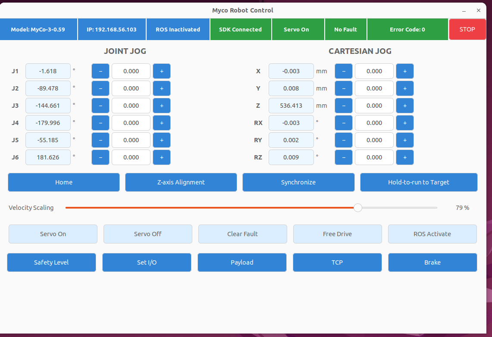

Figure 1. New GUI main page

The top status bar shows:

- **Model**: selected ROS model;
- **IP**: controller address;
- **ROS Activated/Inactivated**: ROS motion-controller ownership;
- **SDK Connected/Disconnected**: port 10003 SDK connection;
- **Servo On/Off, Power Off, etc.**: robot state reported by the controller;
- **No Fault/Fault**: fault state;
- **Error Code**: raw controller error code;
- **STOP**: stop the current robot motion.

Status indicators use controller feedback, not assumptions based on button clicks.

The left side provides joint jogging and the right side provides Cartesian jogging. Light-blue fields show actual values; white fields accept targets. Units are degrees for J1-J6 and RX/RY/RZ, and millimetres for X/Y/Z.

### 3.2 Power, Initialization, and Servo

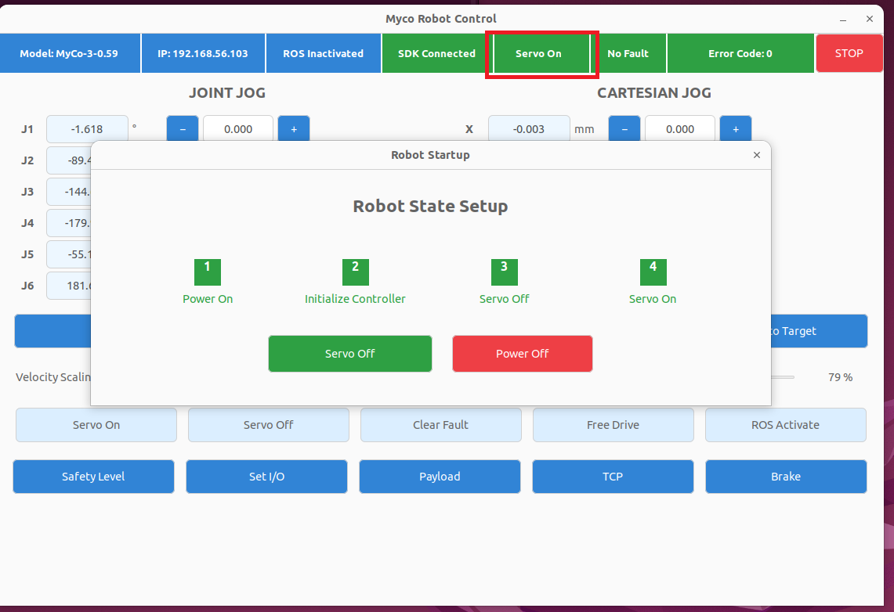

Figure 2. Robot State Setup

The **Robot State Setup** dialog opens automatically when the GUI starts. Click the robot-state field in the top bar to reopen it.

Typical startup sequence:

```text
Power On → Initialize Controller → Servo On
```

| Function | Description |
|---|---|
| Power On | Power on the robot control system |
| Initialize Controller | Establish and initialize the robot control group |
| Servo On | Enable the robot |
| Servo Off | Disable the robot |
| Power Off | Remove power |

Servo operations display a brief notification. The final state must still be confirmed from controller feedback.

### 3.3 Faults, Reset, and Stop

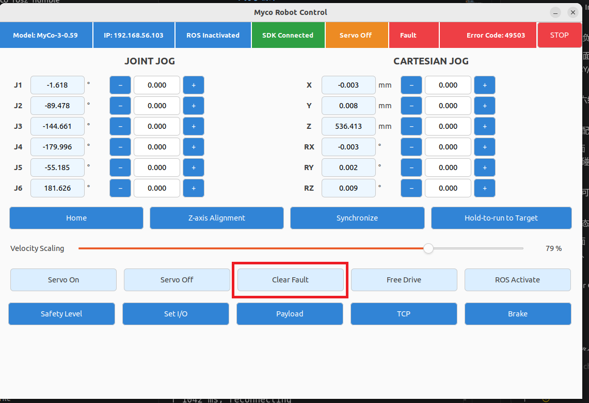

Figure 3. Fault state, error code, and Clear Fault

When a fault occurs, the top bar shows **Fault** and the raw **Error Code**. Remove the external cause, then click **Clear Fault** to reset the robot group.

**STOP** calls the controller group-stop interface `GrpStop` to stop the current robot motion. It is a software stop and is not a safety-rated physical emergency stop. It does not replace the control-cabinet E-stop, safety light curtain, or other hardware safety circuits.

### 3.4 Joint and Cartesian Jogging

Jogging follows a press-to-move, release-to-stop pattern:

1. Hold `+` or `-` beside J1-J6 or X/Y/Z/RX/RY/RZ;
2. The GUI sends START and periodically sends KEEPALIVE;
3. Mouse release, pointer exit, window focus loss, or page change sends STOP;
4. If no keepalive arrives for more than 500 ms, the SDK-node watchdog stops continuous motion.

Joint jogging uses controller `LongJogJ`; Cartesian jogging uses `LongJogL`. Cartesian coordinates describe the current TCP pose relative to Base, not joint angles.

**Velocity Scaling** sets the controller speed ratio from 1% to 100%. Use a low ratio for initial real-robot tests.

### 3.5 Target Motion, Home, and Z-axis Alignment

- **Synchronize**: copy actual joint and Cartesian values into the target fields;
- **Hold-to-run to Target**: hold to move toward the entered target; release to stop;
- **Home**: hold to move toward the zero pose, where all J1-J6 targets are 0°; release to stop;
- **Z-axis Alignment**: progressively align the current TCP orientation with the Base Z axis.

These functions use controller SDK motion and do not pass through MoveIt collision planning. Verify the target, TCP, workspace, and surroundings before operation.

### 3.6 ROS Control and MoveIt

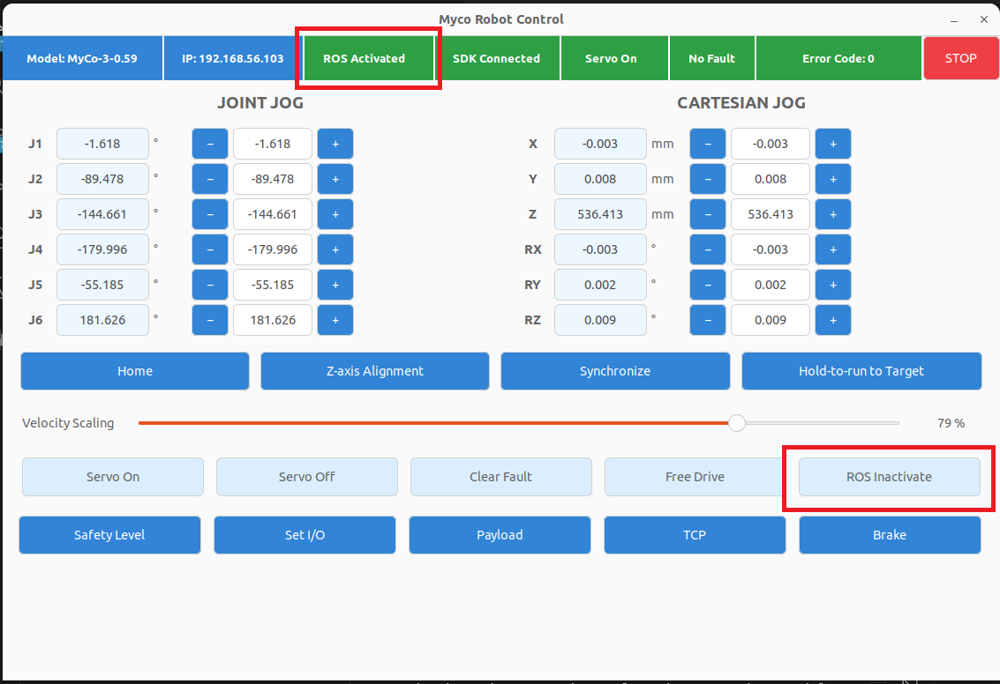

Figure 4. Activate ROS Control before MoveIt execution

Before execution, the robot must be enabled, fault-free, unpaused, with brakes released and Free Drive disabled. After clicking **ROS Activate**:

- the top bar shows `ROS Activated`;
- the button changes to `ROS Inactivate`;
- `myco_arm_controller` becomes active;
- MoveIt can execute trajectories through FollowJointTrajectory.

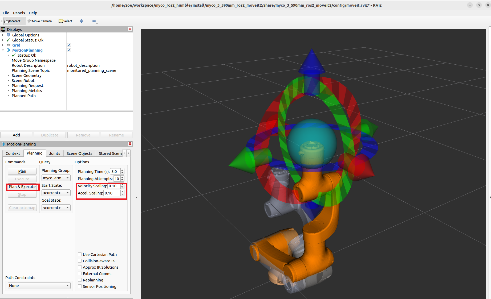

Figure 5. MoveIt planning in RViz

1. Complete Servo On in the GUI;
2. Click **ROS Activate**;
3. Set a target in the RViz MotionPlanning panel;
4. Set velocity and acceleration scaling in RViz;
5. Select Plan and inspect the trajectory;
6. Confirm the area is safe, then select Execute.

GUI Velocity Scaling is a controller-side ratio. RViz velocity/acceleration scaling changes the planned trajectory; the two settings operate at different layers.

### 3.7 Free Drive

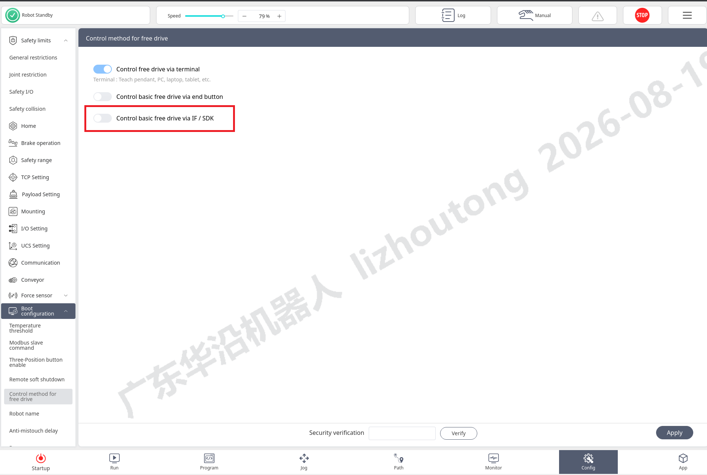

Figure 6. Allow SDK control of Free Drive on the controller

Enable SDK control of Free Drive in the controller configuration first. Click **Free Drive** on the main page to enter free-drive mode and click it again to exit. Button and top-bar states follow controller feedback.

### 3.8 TCP

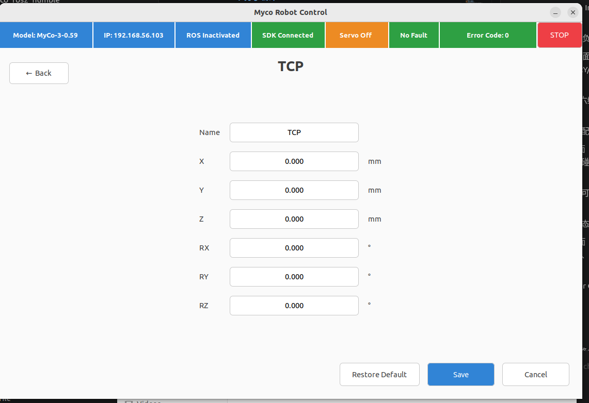

Figure 7. TCP settings

TCP is the tool-center-point pose offset from the robot flange:

- Name: TCP name;
- X/Y/Z: translation in mm;
- RX/RY/RZ: orientation in degrees;
- Save: create or update the named TCP and make it the controller default and current TCP;
- Restore Default: restore the designated default `TCP`;
- Cancel: discard the current entries.

Setting, selecting, or restoring TCP requires Servo Off. After saving, the driver reads back all six values from the controller for verification.

Controller-SDK Cartesian jog and target motion use the current controller TCP. MoveIt uses the end link defined by URDF/SRDF; changing the runtime controller TCP does not modify the MoveIt model.

### 3.9 Payload

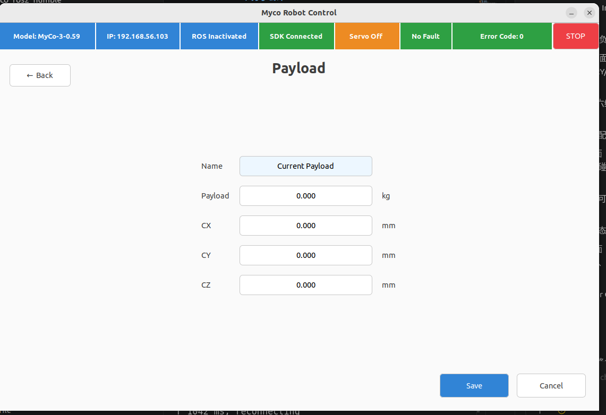

Figure 8. Payload settings

Payload configures tool mass and center of gravity. Mass is in kg; center-of-gravity X/Y/Z values are in mm. Mass must be non-negative and within the controller limit. Configure Payload with Servo Off and use values matching the physical tool.

### 3.10 Safety Level

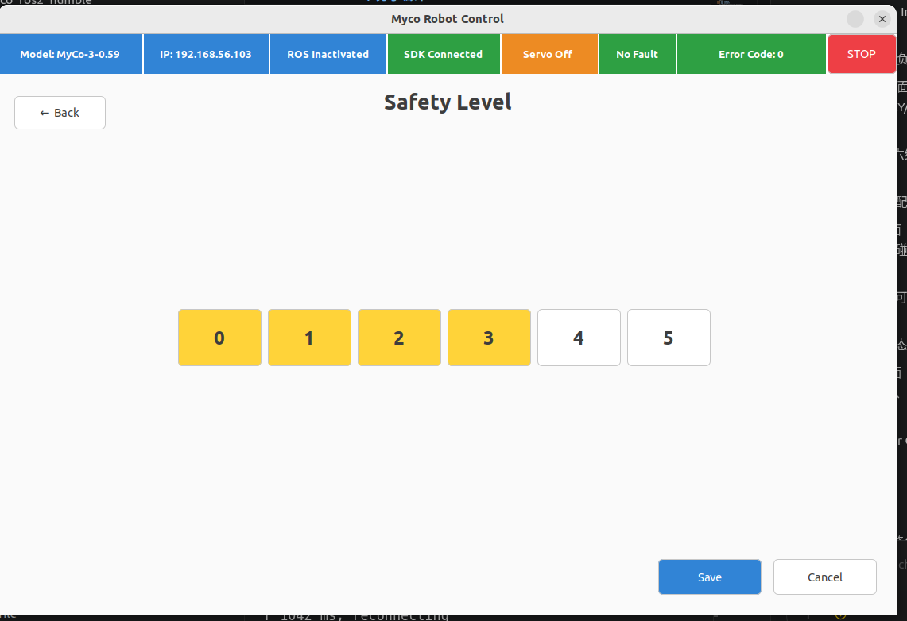

Figure 9. Collision Safety Level

Opening the page reads the actual collision level. Saving writes a value from 0 to 5 and requires Servo Off. Select the level according to payload, application speed, and the site risk assessment.

### 3.11 Set I/O

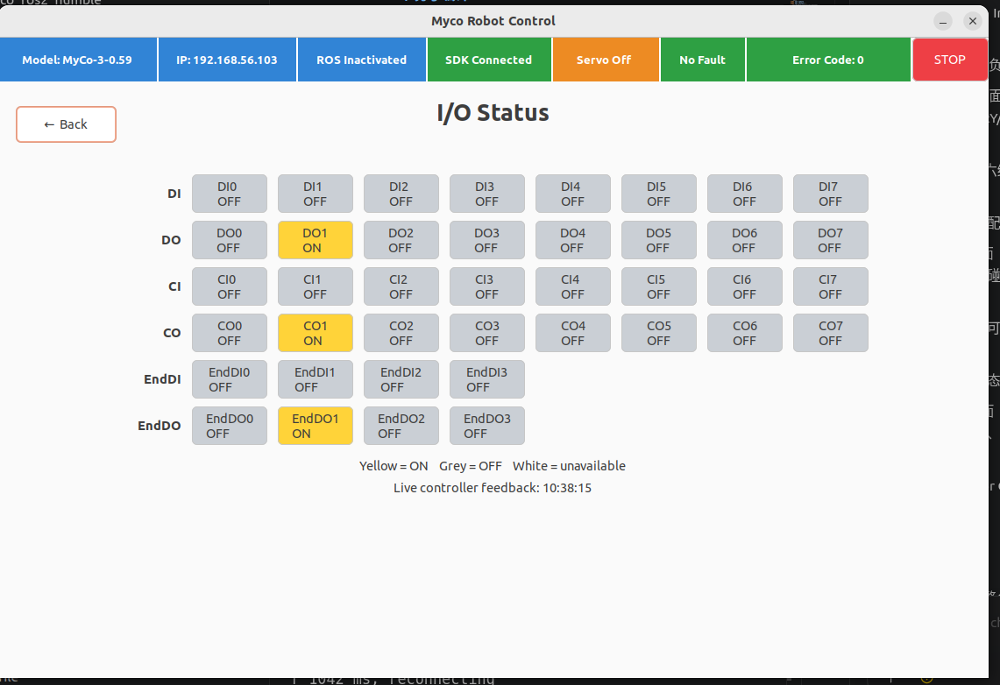

Figure 10. I/O state and output control

- DI, CI, and EndDI are read-only inputs;
- DO, CO, and EndDO are clickable outputs;
- gray means no signal/off; highlighted means signal/on;
- output colors follow state read back through port 10004, not the local click count.

If a service succeeds but the state does not change, check controller I/O configuration, channel mode, and the pushed-state connection.

### 3.12 Brake

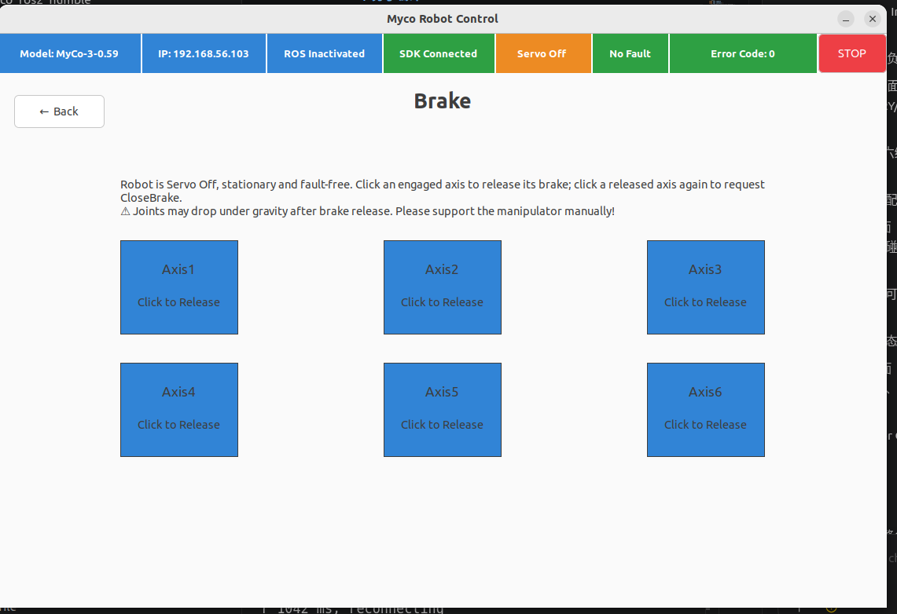

Figure 11. Per-axis brake maintenance

Brake operation is allowed only when Servo is Off, the robot is stationary and fault-free, and controller state is valid. Click an axis to release or re-engage its brake. Mechanically support the axis before release to prevent gravity-driven motion. If the controller rejects brake engagement, the GUI displays the raw error and does not automatically change controller safety states.

## 4. Main ROS Interfaces

### 4.1 State Topics

| Topic | Type | Purpose |
|---|---|---|
| `/joint_states` | `sensor_msgs/msg/JointState` | Standard joint state used by MoveIt, RViz, and TF |
| `/myco_sdk/joint_states` | `sensor_msgs/msg/JointState` | Diagnosis of 8893 parsing and unit conversion |
| `/myco_sdk/realtime_state` | `MycoRealtimeState` | High-rate target/actual joint, TCP, and force data |
| `/myco_sdk/robot_status` | `MycoRobotStatus` | Connection, power, Servo, fault, and ROS Control state |
| `/myco_sdk/io_state` | `MycoIOState` | Control-cabinet I/O state |
| `/myco_sdk/end_io_state` | `MycoEndIOState` | End-effector I/O state |
| `/myco_sdk/brake_state` | `MycoBrakeState` | Six-axis brake state |

Both joint-state topics originate from the same 8893 feedback. `/joint_states` passes through the ros2_control `joint_state_broadcaster` and is the standard application input. `/myco_sdk/joint_states` is published directly by the hardware plugin for diagnostics.

```bash
# Standard joint state
ros2 topic echo /joint_states

# Complete 8893 real-time state
ros2 topic echo /myco_sdk/realtime_state

# Robot and ROS Control state
ros2 topic echo /myco_sdk/robot_status

# Cabinet and end-effector I/O
ros2 topic echo /myco_sdk/io_state
ros2 topic echo /myco_sdk/end_io_state

# Brake state
ros2 topic echo /myco_sdk/brake_state

# Actual publication rates
ros2 topic hz /joint_states
ros2 topic hz /myco_sdk/realtime_state
```

### 4.2 Control Services

| Function | Main service |
|---|---|
| Power and initialization | `/myco_sdk/electrify`, `/myco_sdk/initialize_controller` |
| Servo On/Off | `/myco_sdk/set_enabled` |
| Power Off | `/myco_sdk/blackout` |
| Reset and stop | `/myco_sdk/reset`, `/myco_sdk/stop` |
| ROS Control ownership | `/myco_sdk/set_ros_control` |
| Free Drive | `/myco_sdk/set_freedrive` |
| Speed ratio | `/myco_sdk/set_speed_ratio` |
| TCP | `/myco_sdk/get_tcp_config`, `/myco_sdk/configure_tcp`, `/myco_sdk/restore_default_tcp` |
| Payload | `/myco_sdk/get_payload`, `/myco_sdk/set_payload` |
| Safety Level | `/myco_sdk/get_collision_level`, `/myco_sdk/set_collision_level` |
| I/O | `/myco_sdk/set_digital_io` |
| Brake | `/myco_sdk/set_brake` |
| Jog and target motion | `/myco_sdk/jog`, `/myco_sdk/move_target` |

A successful service response means the controller accepted the request. Confirm completion through the corresponding state topic.

```bash
# Power on and initialize
ros2 service call /myco_sdk/electrify std_srvs/srv/Trigger "{}"
ros2 service call /myco_sdk/initialize_controller std_srvs/srv/Trigger "{}"

# Servo On / Servo Off
ros2 service call /myco_sdk/set_enabled std_srvs/srv/SetBool "{data: true}"
ros2 service call /myco_sdk/set_enabled std_srvs/srv/SetBool "{data: false}"

# Power off, clear fault, and stop current motion
ros2 service call /myco_sdk/blackout std_srvs/srv/Trigger "{}"
ros2 service call /myco_sdk/reset std_srvs/srv/Trigger "{}"
ros2 service call /myco_sdk/stop std_srvs/srv/Trigger "{}"

# Activate / deactivate ROS Control
ros2 service call /myco_sdk/set_ros_control std_srvs/srv/SetBool "{data: true}"
ros2 service call /myco_sdk/set_ros_control std_srvs/srv/SetBool "{data: false}"

# Enable / disable Free Drive
ros2 service call /myco_sdk/set_freedrive std_srvs/srv/SetBool "{data: true}"
ros2 service call /myco_sdk/set_freedrive std_srvs/srv/SetBool "{data: false}"

# Set a 50% controller speed ratio
ros2 service call /myco_sdk/set_speed_ratio \
  myco_robot_msgs/srv/SetFloat64 "{data: 0.5}"

# Read TCP, Payload, and Safety Level
ros2 service call /myco_sdk/get_tcp_config myco_robot_msgs/srv/GetTcpConfig "{}"
ros2 service call /myco_sdk/get_payload myco_robot_msgs/srv/GetPayload "{}"
ros2 service call /myco_sdk/get_collision_level myco_robot_msgs/srv/GetInt32 "{}"

# Example: set cabinet DO0
ros2 service call /myco_sdk/set_digital_io \
  myco_robot_msgs/srv/SetDigitalIO \
  "{domain: 'box_do', index: 0, value: true}"
```

TCP, Payload, Safety Level, and Brake write operations have Servo-state and maintenance constraints. Use the GUI and observe state feedback. Jog and target motion require continuous keepalive and must not be replaced by a single `ros2 service call`.

## 5. Safety and Troubleshooting

### 5.1 Real-Robot Safety

- Clear the robot workspace before operation;
- use a low speed ratio for initial tests;
- verify model, TCP, Payload, and target values;
- inspect the MoveIt trajectory before execution;
- GUI Stop and the software watchdog do not replace a physical E-stop;
- only qualified personnel may operate brakes, with the robot mechanically supported.

### 5.2 Common Problems

| Symptom | Check |
|---|---|
| GUI exits immediately | Graphical environment, wxPython, and complete terminal output |
| SDK Disconnected | IP address, port 10003, and controller SDK service |
| State or I/O does not update | Port 10004 and pushed-state service |
| ros2_control cannot activate | Ports 8892/8893, Servo, faults, brakes, Free Drive, and control cycle |
| Model validation fails | `robot_model` and controller-model mapping |
| Version validation fails | Final CM product-version field in `ReadVersion` |
| RViz plans but cannot execute | Servo On and ROS Activated state |
| Free Drive fails | Controller permission for SDK-controlled Free Drive |
| TCP/Payload/Safety save fails | Servo Off state and input range |
| Output does not change | Channel configuration, service response, and 10004 feedback |

### 5.3 Diagnostic Commands

```bash
ros2 node list
ros2 service list | grep myco
ros2 topic list | grep myco
ros2 control list_controllers
ros2 topic echo /myco_sdk/robot_status
ros2 topic echo /myco_sdk/io_state
ros2 topic hz /joint_states
```

## 6. Command and Parameter Quick Reference

### 6.1 Common Commands

```bash
# Source environments
source /opt/ros/humble/setup.bash
source ~/myco_ros2_ws/install/setup.bash

# Complete controller and new GUI
ros2 launch myco_basic_api myco_gui_new.launch.py \
  robot_model:=MyCo-5-0.80 robot_ip:=192.168.56.103 update_rate:=250

# GUI only (backend must already be running)
ros2 launch myco_basic_api myco_gui_only.launch.py \
  robot_model:=MyCo-5-0.80 robot_ip:=192.168.56.103

# Gazebo, MoveIt, and RViz
ros2 launch myco_robot_bringup myco_control.launch.py \
  robot_model:=MyCo-5-0.80 hardware_type:=gazebo
```

### 6.2 Main Launch Parameters

| Parameter | Description | Common value |
|---|---|---|
| `robot_model` | ROS robot model | `MyCo-5-0.80` |
| `hardware_type` | Hardware type | `controller`, `gazebo`, `ethercat` |
| `robot_ip` | Controller address | Actual site IP |
| `control_mode` | Control mode | `position`, `controller` |
| `update_rate` | ros2_control update frequency | 250 for 4 ms; 1000 for 1 ms |
| `enable_controller_validation` | Model and version validation before startup | `true` |

### 6.3 Recommended Workflows

Real-robot startup:

```text
Check network and ports
→ Start driver and GUI
→ Power On
→ Initialize Controller
→ Clear Fault (if present)
→ Servo On
→ Verify at low speed
```

MoveIt motion:

```text
Servo On
→ ROS Activate
→ Set target and velocity/acceleration in RViz
→ Plan
→ Inspect trajectory
→ Execute
```

Normal shutdown:

```text
Stop motion
→ ROS Inactivate or exit Free Drive
→ Servo Off
→ Power Off
→ Stop ROS with Ctrl+C
```

Do not use `kill -9` for normal shutdown; allow the driver to close its control connections.
